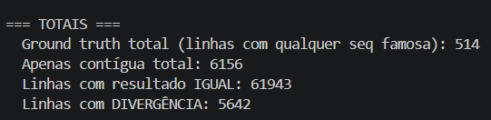
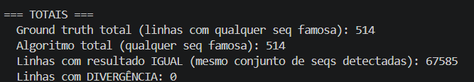

# Pesquisa — Sequências de Acordes Customizadas

## Perguntas que você precisa responder

1. **Algoritmo de matching**: hoje, as 6 sequências hardcoded em `main.py` (linhas
   40-45) são comparadas contra músicas via uma tag pré-computada
   (`SEQ_FAMOSA`/`seqs_famosas`, vinda do CSV). Sequências cadastradas pelo usuário
   não têm essa tag — o matching precisa ser calculado em tempo real a partir da
   lista de acordes de cada música (`musica.acordes`/`musica.cifra`). O que vai
   definir "a sequência X aparece na música Y"? A ordem dos acordes importa?
   Repetições de acorde dentro da música importam? É preciso normalizar (ex.:
   maiúsculas/minúsculas, variações de escrita do mesmo acorde)?
2. **Validação da hipótese**: rode o algoritmo que você está considerando contra os
   dados reais em `data/top/dataset_final.csv`, para as 6 sequências hoje
   hardcoded, e confirme (ou refute) que ele reproduz os mesmos matches que o
   código atual produz via `seqs_famosas`. Esse é o bar mínimo de correção que
   você vai usar na fase de testes.
3. **Banco de dados**: quais bancos embarcados (sem serviço externo adicional) são
   viáveis dentro do container Docker único e local-only já documentado em
   `docs/adr/0001-local-only-docker-deploy.md`? O que cada opção implica para o
   `Dockerfile` atual e para a persistência dos dados entre reinícios do
   container?
4. **Frontend existente**: o que a página `#/porsequencia`
   (`static/templates/sequencia.html` +
   `static/assets/js/controllers/sequencia.js`) já faz? Repare que ela tem hoje uma
   lista *hardcoded no JavaScript* de 4 sequências (`sequencia1`..`sequencia4`),
   diferente das 6 que existem no backend — um detalhe real e pré-existente do
   código, não um erro seu, que vale entender antes de decidir o que precisa
   mudar.

## Registro das descobertas

1. O que irá definir se a sequência X aparece na música Y é verificar se a sequência completa digitada, em ordem, pelo usuário está contida pelo menos uma vez na lista de cifras que a música possui e se o conjunto de acordes das cifra é composto apenas pelos acordes da sequencia digitada. A música possui tanto lista de acordes quanto lista de cifras, mas a cifra está ordenada como vem na música (main.py:11-23), e os acordes são só todos os acordes distintos presentes na música (musica.py:17). Logo, por a ordem da sequência importar, a ordem dos acordes importa para analisar se a sequencia esta presente pelo menos uma vez na música. Pois, se não fosse considerar a ordem da sequência de acordes digitada pelo usuário, acabaria ficando parecido com a lógica do get_similares na página porAcordes. A repetição de acordes se for dentro da sequência importa, pois se a cifra repete um acorde e a sequência digitada não tem essa repetição naquela posição, a música não contém a sequência exata, pois para dar um match é necessária a igualdade de todos os acordes pelo menos uma vez. Quanto à normalização, se o cadastro for por seleção de botões pré-definidos, assim como acontece na página do porAcordes, a normalização não precisa ocorrer pois a lista de acordes já chegaria formatada. Porém, se for por digitação livre pelo usuário, aí sim seria necessário normalizar como acontece no limpa_cifra(main.py:11-23).

   As principais referências para formular minha resposta foram as perguntas documentadas nos arquivos:

   . `research/codebase_research20251028_pt.md`

   .  `research/condicoes_sequencias_famosas_dataset.md`

   .  `research/normalizacao_acordes.md`

   .  `research/sequencia_aparece_seguida.md`

2. Após pedir ao opencode para gerar um algoritmo com base nas minhas decisões acima, e também um script que lesse o dataset_final.csv comparando os matches registrados na coluna SEQ_FAMOSA com os resultados que o meu algoritmo retorna, percebi que a minha hipótese estava correta. Pois, em uma primeira tentativa usando apenas a condição da sequencia estar presente na cifras, o reultado do csv rodado no meu algoritmo deu diferente dos resultados que estavam presentes no csv: 

   

   Após a adição da segunda condição o meu algoritmo produziu a mesma saida que o csv apontava: 

   

   O processo foi registrado em: `research/algoritmo/test_hipotese_sequencias_famosas.py`.

3. Seguindo a adr-0001 e em conversa no opencode utilizando a skill /research-codebase 3 opções de bancos foram listadas: SQLite, DuckDB e TinyDB. Não possui impacto no dockerfile para essas opções, pois no SQLite python ja suporta uma biblioteca sqlite3, e o DuckDB ou o TinyDB precisaria apenas adicionar os seus pacotes no requirements.txt. Como os três são bancos embarcados, eles salvam os dados dentro do sistema de arquivos do próprio container, que persiste a reinícios. 
      As principais referências para formular minha resposta foram as perguntas documentadas nos arquivos:

      . `research/docker_unico_e_banco_embarcado_existente.md`

      . `research/bancos_embarcados_compativeis_docker_unico.md`
      
      . `research/implicacoes_bancos_dockerfile_persistencia.md.`

4. A página por sequência mostra 4 sequências hardcoded (static/assets/js/controllers/sequencia.js:2-37) e, quando você clica em uma delas, aparecem todas as músicas que possuem essa sequência independente do gênero. Caso você queira filtrar por um gênero específico, basta escolher um valor no select (static/templates/sequencia.html:24-30) que lista os gêneros existentes. Ao escolher, a busca é refeita com o parâmetro &generos=(que é opcional) adicionado ao request. Caso você clique em outra das 4 sequências mostradas na página a busca é refeita, pois não é possível selecionar mais de uma sequência por vez. As músicas são mostradas por ordem de popularidade (static/templates/sequencia.html:40-59). 

   As principais referências para formular minha resposta foram as perguntas documentadas nos arquivos:

   .  `research/codebase_research20251028_pt.md`

   .  `research/front_end_porsequencia.md`

## Trade-offs identificados

. Com esse algoritmo, a regra tem duas condições bem especificas. Se o usuário esperar “qualquer música que contenha a sequência pelo menos uma vez” (minha ideia inicial, em research/algoritmo/test_apenas_contigua.py), o resultado será diferente, pois a segunda condição exclui músicas que usam outros acordes além dos da sequência.

. Os bancos listados salvam os dados em um arquivo dentro do próprio container, logo, entre reinicios do container os dados são persistidos mas se o container for recriado os dados não são persistidos. 

. Da forma que o frontend mostra as sequências hoje, por utilizar apenas sequências hardcoded definidas em sequencia.js, nem todas as 6 sequências hardcoded no backend são exibidas. Dessa forma, sequências futuras adicionadas por um usuário também não seriam exibidas.
